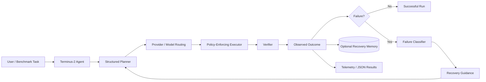
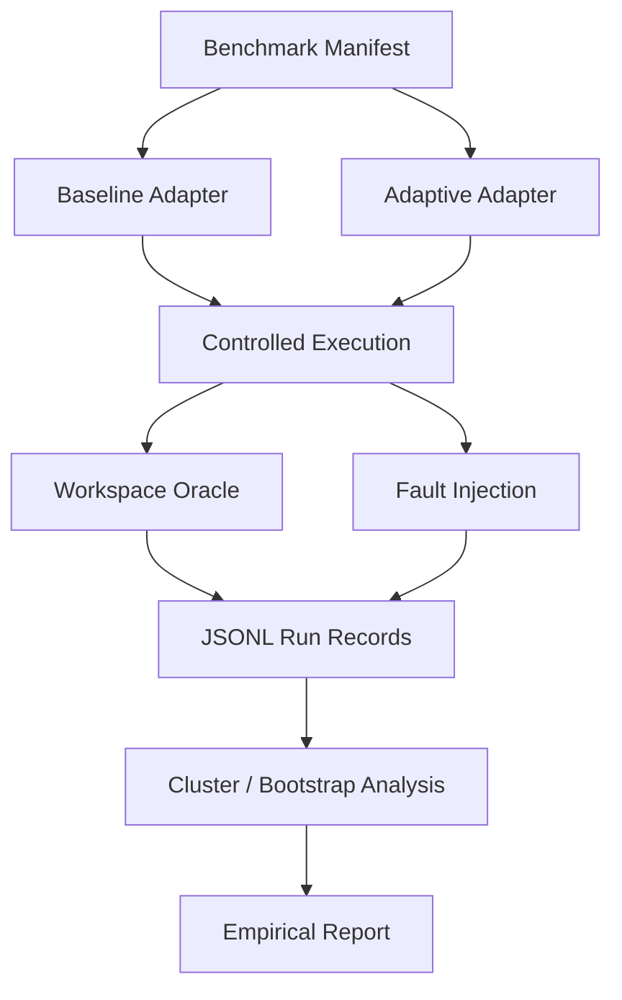

# Terminus-2 Adaptive Agent

> A Windows-first AI-agent engineering project extending Harbor / Terminus-2 with adaptive execution, recovery-aware orchestration, provider routing, observability, and reproducible regression infrastructure.

[](https://www.python.org/)
[](https://docs.astral.sh/uv/)
[](https://github.com/BerriAI/litellm)
[](https://www.microsoft.com/windows)
[](#project-status)

## Overview

This project is a hands-on engineering extension of **Terminus-2 within the Harbor framework**. The goal is not simply to run an existing terminal agent, but to build and validate the engineering layers around reliable agent execution.

The project focuses on:

- **Adaptive failure handling** — classify terminal failures and generate structured recovery guidance.
- **Guarded orchestration** — validate plans, dependencies, state transitions, remediation, and execution boundaries.
- **Model/provider routing** — use shared LLM abstractions while keeping provider-specific behavior explicit.
- **Observability** — capture recovery events and structured run outcomes.
- **Recovery memory** — optionally persist recovery outcomes for future decision support.
- **Evaluation tooling** — provide offline regression checks and a structured benchmark/evaluation harness.
- **Windows-first reproducibility** — document and validate the Python, uv, Rust, MSVC, Docker, and LiteLLM toolchain required for development.

> **Important:** This is an experimental extension/project built from and around Harbor/Terminus-2. It is not presented as an official Harbor release or upstream feature.

## Architecture


### High-level execution flow



The key design principle is **closed-loop recovery without blindly retrying shell commands**. A command may have timed out after partially changing the environment, so recovery decisions should be based on observed state rather than unconditional repetition.

## Engineering Principles

### 1. Separate planning from execution

Model-generated planning is represented as structured data rather than executable shell text.

The execution boundary is responsible for:

- validating the proposed action,
- enforcing policy,
- executing through an injected executor,
- collecting results,
- verifying the resulting state.

This keeps the model from directly owning the system execution boundary.

### 2. Treat failures as information

Instead of reducing every failure to `retry`, the adaptive layer distinguishes failure categories and produces structured recovery guidance.

Conceptually:

```text
terminal outcome
      │
      ▼
failure classification
      │
      ├── transient/environment issue
      ├── dependency/state issue
      ├── invalid action
      └── unresolved task failure
      │
      ▼
recovery guidance
      │
      ▼
validated remediation plan
      │
      ▼
guarded execution + verification
```

### 3. Make observability first-class

Recovery events can be represented as structured records so that an execution is inspectable after the fact.

The project includes tooling for:

- per-run recovery telemetry,
- JSON-safe executor results,
- structured benchmark records,
- append-only JSONL results,
- task-cluster analysis,
- repeatability checks.

### 4. Keep evaluation claims empirical

The benchmark/evaluation tooling is designed to make controlled experiments possible. It does **not** automatically establish that adaptive execution improves real-world agent performance.

Performance claims should come only from reviewed adapters, controlled execution, independent verification, and measured campaigns.

## Adaptive Execution Model

The adaptive layer follows a guarded loop:

```text
Observe
   ↓
Classify
   ↓
Plan
   ↓
Validate
   ↓
Execute
   ↓
Verify
   ↓
Learn / Record
   ↺
```

The system deliberately avoids treating every error as permission to repeat the previous command.

This is particularly important for terminal agents because:

- a timeout may occur after a command has already executed,
- package installation may partially modify an environment,
- files may have been created before a process failed,
- external services may have accepted a request even when the client timed out.

The recovery layer therefore emphasizes **state-aware remediation**.

## Provider and Model Routing

The project builds on Harbor's existing `BaseLLM` abstraction rather than creating a parallel provider stack.

The routing layer is designed to keep:

- provider selection,
- model selection,
- credentials,
- execution policy,
- fallback behavior

explicit and testable.

This makes it easier to reason about multi-provider environments and prevents provider-specific assumptions from leaking throughout the orchestration code.

## Evaluation Architecture



The evaluation harness includes a frozen benchmark manifest, paired execution structure, workspace oracles, controlled fault-injection hooks, append-only JSONL records, and task-cluster analysis.

It is intentionally separated from claims about external-model performance.

## Validation

The focused regression suite for the adaptive/routing/runner changes currently passes:

**633 passed, 5 skipped**

Additional checks:

```text
uv lock --check --offline    PASS
Ruff lint                    PASS
Formatting                   PASS
```

The focused suite covers areas including:

- OSWorld adapter behavior
- installed-agent runners
- model routing
- multi-provider routing
- OpenHands MCP behavior
- Strands execution
- runner safety/regression behavior

> The full historical `tests/unit` suite was not treated as a release gate because unrelated failures remained in other areas of the upstream codebase. The number above is the focused regression result, not a claim that the entire upstream suite is green.

## Windows Development Environment

This project was validated on Windows 11 using:

| Component | Validated setup |
|---|---|
| OS | Windows 11 |
| Python | 3.13.x |
| Package manager | uv 0.13.5 |
| LLM runtime | LiteLLM 1.93.0 |
| Rust | 1.99.1 |
| Cargo | 1.99.1 |
| Native build | MSVC / Visual Studio Build Tools |
| Containers | Docker |
| Project tooling | Harbor CLI / Python package |

### Why Rust + MSVC matter

Some Python dependencies contain native Rust components. On Windows, these packages require a working native build environment.

For this project that means:

```text
Python
  ↓
uv
  ↓
Python dependency resolution
  ↓
native Rust extension
  ↓
Rust + MSVC linker
  ↓
Windows wheel
```

A correctly configured MSVC toolchain is therefore part of the reproducible development environment rather than an optional convenience.

## Getting Started

Clone the repository and enter the project:

```powershell
git clone https://github.com/tejasash2005-sketch/terminus-2-adaptive-agent.git
cd terminus-2-adaptive-agent
```

Install dependencies with uv:

```powershell
uv sync
```

Check the Harbor CLI:

```powershell
uv run harbor --help
```

Run the focused regression suite:

```powershell
uv run pytest `
  tests/unit/adapters/test_osworld.py `
  tests/unit/agents/installed/test_antigravity_cli.py `
  tests/unit/agents/installed/test_deerflow.py `
  tests/unit/agents/installed/test_hermes_cli.py `
  tests/unit/agents/installed/test_mini_swe_agent.py `
  tests/unit/agents/installed/test_model_routing_matrix.py `
  tests/unit/agents/installed/test_multi_provider_model_routes.py `
  tests/unit/agents/installed/test_openhands_mcp.py `
  tests/unit/agents/installed/test_strands.py `
  tests/unit/agents/installed/test_strands_runner.py `
  -q -p no:cacheprovider --tb=short
```

## Project Structure

```text
terminus-2-adaptive-agent/
├── adapters/                     # Agent / environment adapters
├── apps/                         # Harbor applications
├── benchmarks/                  # Benchmark and evaluation tooling
├── docs/
│   └── images/
│       └── terminus2-adaptive-architecture.png
├── src/
│   └── harbor/
│       ├── agents/
│       │   └── installed/
│       │       ├── strands.py
│       │       └── ...
│       └── ...
├── tests/
│   └── unit/
├── AGENTS.md
├── README.md
└── pyproject.toml
```

## Engineering Highlights

### Recovery-aware terminal intelligence

Adds structured failure classification and recovery guidance instead of relying on unconditional retries.

### Policy-enforcing execution

Separates model planning from execution through injected executor/verifier boundaries.

### Multi-provider routing

Strengthens model routing and provider isolation while preserving Harbor's shared LLM abstraction.

### Regression hardening

Adds focused regression coverage around Windows-sensitive runners, routing behavior, provider handling, and installed-agent integrations.

### Phase 7 release hardening

Includes stricter autonomous-run configuration and checkpoint validation, JSON-safe executor contracts, cancellation checkpoints, unique atomic checkpoint staging, and repeatability validation.

### Phase 8 empirical evaluation harness

Adds a frozen benchmark manifest, paired baseline/adaptive execution structure, workspace oracles, fault-injection hooks, JSONL records, and task-cluster bootstrap analysis.

## Security and Safety

The project follows several practical boundaries:

- Do not execute raw model-generated shell text without an explicit execution boundary.
- Do not assume a timed-out command is safe to retry.
- Validate structured plans before execution.
- Keep credentials outside source control.
- Keep provider credentials explicit and isolated.
- Prefer deterministic/offline regression tests where possible.
- Treat benchmark results as experimental measurements rather than automatic proof of superiority.

## Project Status

**Current status: active engineering / portfolio project**

Completed engineering work includes:

- adaptive terminal-failure classification,
- structured recovery guidance,
- guarded sequential orchestration,
- provider/model routing improvements,
- recovery telemetry and optional memory,
- evaluation tooling,
- Windows development infrastructure,
- focused regression hardening,
- professional architecture documentation.

The project remains experimental where external-model evaluation is concerned. Measured baseline-versus-adaptive performance should be generated from a controlled campaign before being presented as a result.

## About Harbor

[Harbor](https://github.com/harbor-framework/harbor) is a framework from the creators of Terminal-Bench for evaluating and optimizing agents and language models.

This project uses Harbor as its engineering foundation and extends it for the purposes described above.

For upstream documentation and ecosystem resources:

- [Harbor repository](https://github.com/harbor-framework/harbor)
- [Harbor documentation](https://harborframework.com/docs)
- [Harbor Cookbook](https://github.com/harbor-framework/harbor-cookbook)
- [Terminal-Bench](https://www.tbench.ai)

## Provenance and Attribution

This repository contains substantial upstream-derived Harbor/Terminus-2 material alongside project-specific engineering changes.

The adaptive execution, recovery, routing, evaluation, documentation, and regression work described in this README should be understood as the scope of this project rather than as an assertion of upstream authorship.

See the repository's provenance and audit documentation for a more detailed accounting.

## License

This project follows the licensing and attribution requirements of the underlying Harbor project and its included components. Refer to the repository's license files and upstream notices for the applicable terms.

## Portfolio Summary

**Terminus-2 Adaptive Agent** demonstrates practical AI-agent engineering across:

- agent orchestration,
- terminal execution safety,
- failure recovery,
- LLM/provider routing,
- observability,
- benchmark infrastructure,
- regression testing,
- Windows native build systems,
- Docker-based environments,
- reproducible Python tooling.

The emphasis is on building a system that is **observable, testable, policy-aware, and honest about what has and has not been empirically demonstrated**.
